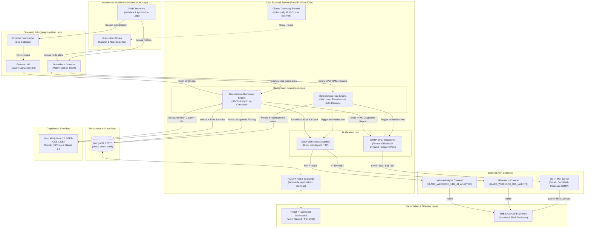
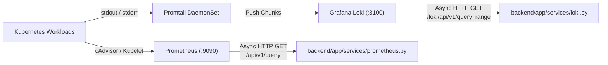
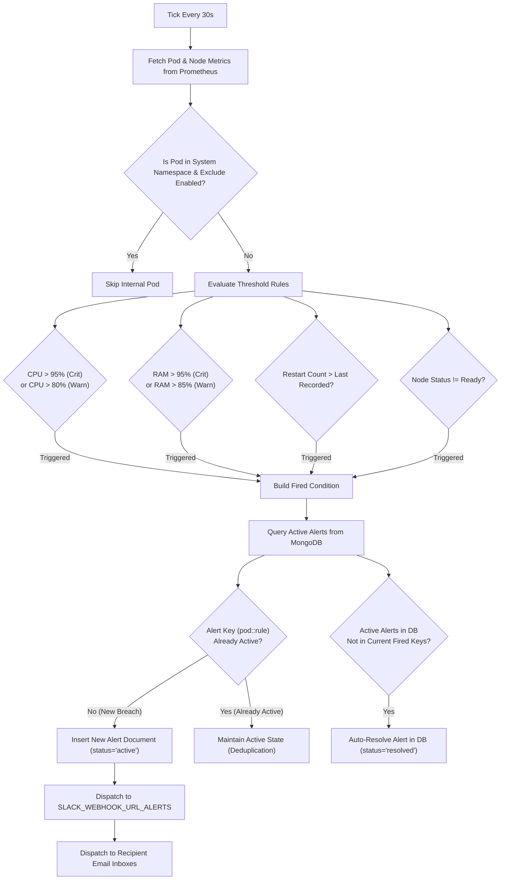
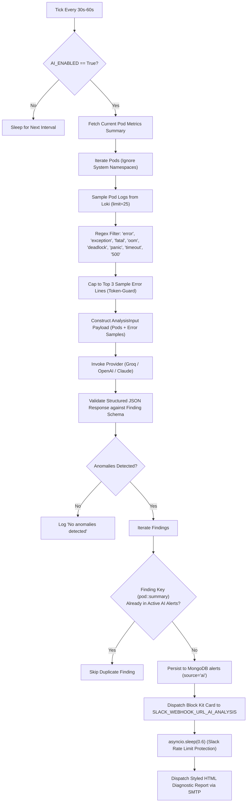
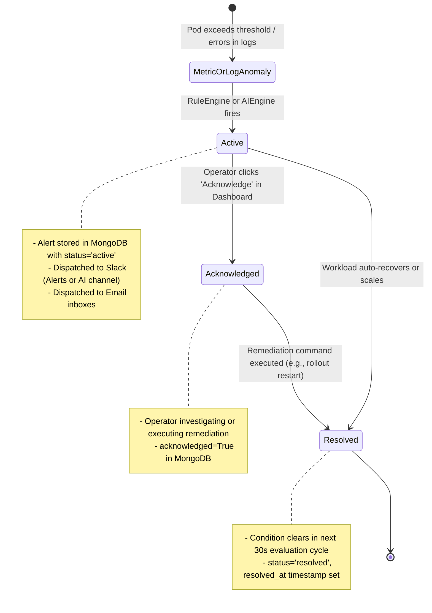
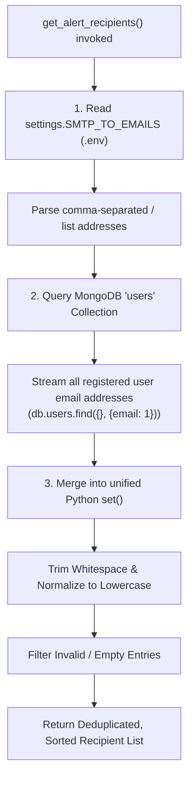
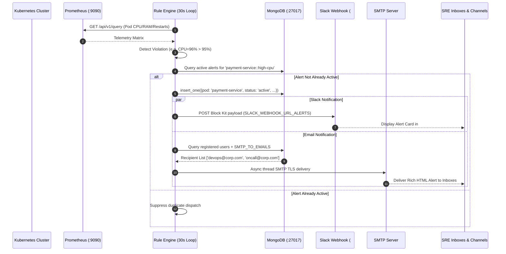
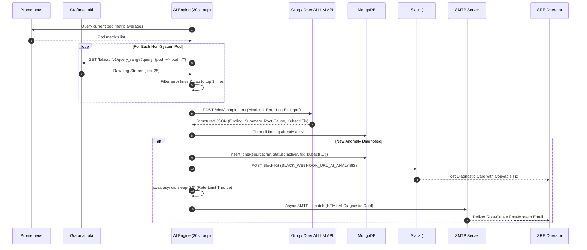
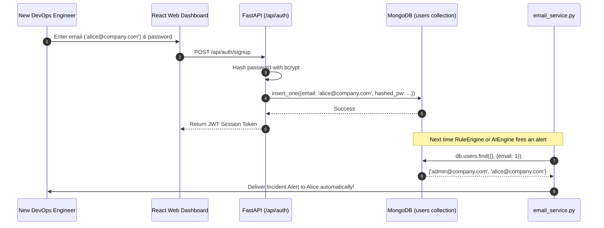

# 🏛️ Architecture & Workflow Specification

This document provides a comprehensive, production-grade architectural specification of the **Kubernetes Monitoring & Autonomous AI Observability Platform**. It details the end-to-end telemetry pipeline, the autonomous AI evaluation engine, and the multi-channel notification architecture across **Slack ChatOps** and **SMTP Email**.

---

## 📑 Table of Contents

1. [Executive Summary & System Vision](#1-executive-summary--system-vision)
2. [Global System Architecture Diagram](#2-global-system-architecture-diagram)
3. [Component Breakdown by Layer](#3-component-breakdown-by-layer)
4. [End-to-End Project Workflows](#4-end-to-end-project-workflows)
   - [Workflow A: Telemetry & Log Ingestion Pipeline](#workflow-a-telemetry--log-ingestion-pipeline)
   - [Workflow B: Deterministic Threshold Rule Engine](#workflow-b-deterministic-threshold-rule-engine)
   - [Workflow C: Autonomous AI Anomaly & Root-Cause Engine](#workflow-c-autonomous-ai-anomaly--root-cause-engine)
   - [Workflow D: Incident Alert Lifecycle & Auto-Healing](#workflow-d-incident-alert-lifecycle--auto-healing)
5. [Deep Dive: Slack ChatOps Integration](#5-deep-dive-slack-chatops-integration)
   - [Dual-Webhook Architecture](#dual-webhook-architecture)
   - [Slack Block Kit Construction](#slack-block-kit-construction)
   - [Rate-Limiting & Async HTTP Dispatch](#rate-limiting--async-http-dispatch)
6. [Deep Dive: SMTP Email Notification System](#6-deep-dive-smtp-email-notification-system)
   - [Dual-Channel Notification Strategy](#dual-channel-notification-strategy)
   - [Dynamic Recipient Discovery Engine](#dynamic-recipient-discovery-engine)
   - [Non-Blocking Async Thread Offloading](#non-blocking-async-thread-offloading)
   - [Individual Envelope Privacy Delivery](#individual-envelope-privacy-delivery)
   - [Cryptographic Security (SSL vs STARTTLS)](#cryptographic-security-ssl-vs-starttls)
   - [Responsive HTML & Plain-Text Multipart Templates](#responsive-html--plain-text-multipart-templates)
7. [System Sequence Diagrams](#7-system-sequence-diagrams)
   - [Sequence 1: Threshold Metric Breach to Multi-Channel Dispatch](#sequence-1-threshold-metric-breach-to-multi-channel-dispatch)
   - [Sequence 2: Log-Correlated AI Root-Cause Diagnostic Pipeline](#sequence-2-log-correlated-ai-root-cause-diagnostic-pipeline)
   - [Sequence 3: User Signup & Dynamic Alert Recipient Synchronization](#sequence-3-user-signup--dynamic-alert-recipient-synchronization)
8. [Data Models & State Transitions](#8-data-models--state-transitions)
9. [Resilience, Fault Tolerance & Security Considerations](#9-resilience-fault-tolerance--security-considerations)

---

## 1. Executive Summary & System Vision

Traditional monitoring platforms (e.g., standard Prometheus/Alertmanager setups) notify SREs and developers that an operational threshold has failed (e.g., `CPU > 85%` or `CrashLoopBackOff`), leaving on-call engineers to manually correlate metrics, tail logs across multiple pods, identify the root cause, and formulate remediation commands under high stress.

This platform bridges that gap by implementing a **dual-engine architecture**:
1. **Deterministic Rule Engine**: Instantly catches hard metric violations (CPU, Memory, CrashLoop restarts, Node readiness) every 30 seconds and notifies operators via low-latency channels.
2. **Autonomous AI Diagnostic Engine**: Periodically aggregates container telemetry alongside live error log excerpts from Grafana Loki, passes them through high-throughput LLMs (Groq, OpenAI, Anthropic, or Azure OpenAI), determines the root cause, and provides exact, copy-pasteable `kubectl` commands.
3. **Multi-Channel Alerting Hub**: Dispatches decoupled alerts and diagnostic cards across **Slack** (via dual Block Kit webhooks) and **Email** (via asynchronous SMTP with dynamic registered user discovery).

---

## 2. Global System Architecture Diagram



---

## 3. Component Breakdown by Layer

| Layer | Component | Source Location | Responsibility |
|---|---|---|---|
| **Cluster & Telemetry** | Prometheus Operator | Port `9090` | Collects 15s pod and node metrics (`container_cpu_usage_seconds_total`, `container_memory_working_set_bytes`, `kube_pod_container_status_restarts_total`). |
| **Cluster & Telemetry** | Grafana Loki & Promtail | Port `3100` | Aggregates stdout/stderr logs from all pods. Exposes LogQL query API for real-time streaming and targeted log searches. |
| **Ingestion & Discovery** | Cluster Discovery | [`cluster_discovery.py`](file:///home/f33/Documents/k8s-monitoring-tool/backend/app/services/cluster_discovery.py) | Parses `$KUBECONFIG`, `~/.kube/config`, and `~/.kube/*.yaml` to auto-detect AWS EKS, Azure AKS, GCP GKE, and local Minikube clusters. |
| **Telemetry Clients** | Prometheus & Loki Clients | [`prometheus.py`](file:///home/f33/Documents/k8s-monitoring-tool/backend/app/services/prometheus.py)<br/>[`loki.py`](file:///home/f33/Documents/k8s-monitoring-tool/backend/app/services/loki.py) | High-performance asynchronous HTTP clients using `httpx` for querying metrics and retrieving pod log lines. |
| **Core Engine** | Threshold Rule Engine | [`rule_engine.py`](file:///home/f33/Documents/k8s-monitoring-tool/backend/app/services/rule_engine.py) | Background worker executing every 30 seconds. Evaluates CPU/RAM thresholds, restart rate deltas, and node conditions. Manages active/resolved alert transitions. |
| **Cognitive Engine** | AI Anomaly Engine | [`ai_engine.py`](file:///home/f33/Documents/k8s-monitoring-tool/backend/app/services/ai_engine.py)<br/>[`services/ai/`](file:///home/f33/Documents/k8s-monitoring-tool/backend/app/services/ai/) | Background worker executing every 30-60 seconds. Aggregates pod telemetry, extracts recent error logs, invokes LLMs, and synthesizes root-cause analyses with actionable remediation scripts. |
| **ChatOps** | Slack Webhook Service | [`slack.py`](file:///home/f33/Documents/k8s-monitoring-tool/backend/app/services/slack.py) | Formats and dispatches structured Block Kit JSON payloads across separate alert and AI analysis webhooks. |
| **Email Service** | SMTP Alert Service | [`email_service.py`](file:///home/f33/Documents/k8s-monitoring-tool/backend/app/services/email_service.py) | Dynamic recipient resolution engine, thread-offloaded SMTP delivery, MIME multipart HTML/Text generation, and test verification endpoint. |
| **State & Storage** | MongoDB Database | Port `27017` / Motor Async | Stores active/resolved alerts, registered user accounts, and historical incident records. |
| **API Gateway** | FastAPI REST Server | [`main.py`](file:///home/f33/Documents/k8s-monitoring-tool/backend/app/main.py)<br/>[`api/`](file:///home/f33/Documents/k8s-monitoring-tool/backend/app/api/) | Exposes secured REST endpoints (`/api/alerts`, `/api/metrics`, `/api/logs`, `/api/clusters`, `/api/config`) with JWT auth. |
| **Frontend** | React Dashboard | [`frontend/src/`](file:///home/f33/Documents/k8s-monitoring-tool/frontend/src/) | Modern dark-themed cyber dashboard with real-time health sparklines, grouped alerts, log viewer, and manual remediation triggers. |

---

## 4. End-to-End Project Workflows

### Workflow A: Telemetry & Log Ingestion Pipeline



1. **Metrics Scraping**: Prometheus scrapes pod and node metrics every 15 seconds. Pod CPU usage is computed from `rate(container_cpu_usage_seconds_total[1m])` and compared against limits or cores. Pod RAM is queried via `container_memory_working_set_bytes`.
2. **Log Streaming**: Promtail tails pod logs on each node and pushes compressed chunks to Grafana Loki.
3. **Async Fetching**: The backend uses asynchronous HTTP clients (`httpx.AsyncClient`) with connection pooling and 5-second timeouts to pull metrics and logs without blocking other threads.
4. **Namespace Filtering**: Internal Kubernetes namespaces (`kube-system`, `kube-public`, `kube-node-lease`, `monitoring`) can be excluded from user notifications via `EXCLUDE_SYSTEM_NAMESPACES=true`.

---

### Workflow B: Deterministic Threshold Rule Engine

The Threshold Rule Engine ([`rule_engine.py`](file:///home/f33/Documents/k8s-monitoring-tool/backend/app/services/rule_engine.py)) operates in a continuous background loop initiated upon FastAPI application startup.



- **Threshold Matrix**:
  - **Critical CPU**: `cpu_percent > 95%`
  - **Warning CPU**: `cpu_percent > 80%`
  - **Critical Memory**: `memory_percent > 95%`
  - **Warning Memory**: `memory_percent > 85%`
  - **CrashLoopBackOff**: `pod.restart_count > last_recorded_restart_count`
  - **Node Offline**: `node.status != "Ready"`
- **Deduplication Key**: Composite key `f"{pod}::{rule}"`. If an alert is already `active` in MongoDB, duplicate notification dispatches are prevented.
- **Auto-Resolution**: If a previously active alert key is no longer detected in the current metric evaluation cycle, the document status is automatically transitioned to `resolved` with a `resolved_at` UTC timestamp.

---

### Workflow C: Autonomous AI Anomaly & Root-Cause Engine

The Autonomous AI Engine ([`ai_engine.py`](file:///home/f33/Documents/k8s-monitoring-tool/backend/app/services/ai_engine.py)) runs concurrently in the background every 30 to 60 seconds.



#### Token Optimization & Safety:
To ensure high inference speed and minimize token costs:
1. Logs are filtered using high-precision error signatures (`error`, `exception`, `fatal`, `warn`, `panic`, `timeout`, `oom`, `deadlock`, `refused`, `504`, `500`).
2. Log samples are capped strictly to **3 lines per pod**.
3. Prompts enforce strict single-block JSON generation without conversational preamble, parsed directly into Pydantic models.

---

### Workflow D: Incident Alert Lifecycle & Auto-Healing



---

## 5. Deep Dive: Slack ChatOps Integration

The Slack integration ([`slack.py`](file:///home/f33/Documents/k8s-monitoring-tool/backend/app/services/slack.py)) implements a dual-stream architecture separating noise from deep intelligence.

### Dual-Webhook Architecture

```
                    ┌──────────────────────────────────────────────┐
                    │               Backend Engine                 │
                    └──────────────┬────────────────┬──────────────┘
                                   │                │
            Threshold Breach Fired │                │ AI Root Cause Diagnosed
                                   ▼                ▼
                     ┌───────────────────┐    ┌───────────────────┐
                     │ send_slack_alert  │    │send_slack_ai_find.│
                     └─────────┬─────────┘    └─────────┬─────────┘
                               │                        │
                               ▼                        ▼
                   SLACK_WEBHOOK_URL_ALERTS   SLACK_WEBHOOK_URL_AI_ANALYSIS
                               │                        │
                               ▼                        ▼
                       #k8s-alerts Channel      #k8s-ai-insights Channel
                       (Immediate PagerDuty)    (Actionable Remediation)
```

1. **`SLACK_WEBHOOK_URL_ALERTS`**: Used for immediate threshold-based alarms. It outputs high-priority operational telemetry (Pod name, Namespace, Severity badge, and breached metric value).
2. **`SLACK_WEBHOOK_URL_AI_ANALYSIS`**: Used strictly for synthesized AI diagnostic findings. It isolates verbose root-cause explanations and multi-line remediation commands from high-frequency alert channels.

### Slack Block Kit Construction

All messages leverage Slack's native **Block Kit UI framework** for clean typography, visual hierarchy, and easy mobile reading:

#### 1. Threshold Alert Block Kit Structure:
- **Header Block**: Displays dynamic severity icons (`🚨 [CRITICAL]` or `⚠️ [WARNING]`) and the violated rule name.
- **Section Block (2-Column Fields)**: Displays Pod, Namespace, Severity, and UTC Timestamp.
- **Section Block (Markdown)**: Details the exact metric value (e.g., `96.4% CPU utilization`).
- **Divider Block**: Visually isolates multiple incident cards.

#### 2. AI Incident Insight Block Kit Structure:
- **Header Block**: Displays `🔎 AI Incident Insights — <pod-name>`.
- **Metadata Fields**: Pod, Namespace, Severity badge (`🔴 CRITICAL`, `🟡 WARNING`, `🔵 INFO`), and Analyzed At timestamp.
- **Summary Section**: Clean summary of the observed anomaly.
- **Likely Root Cause Section**: Plain-English explanation of why the failure occurred.
- **Recommended Action Section**: Formatted within a code block (```` ```kubectl ...``` ````) for single-tap copying and execution by on-call engineers.

### Rate-Limiting & Async HTTP Dispatch
- Dispatches are performed asynchronously via `httpx.AsyncClient` with a strict connection timeout (5.0s for raw alerts, 10.0s for AI payloads).
- When multiple AI anomalies fire simultaneously, a **600ms throttle** (`await asyncio.sleep(0.6)`) is enforced between outgoing webhook calls to prevent Slack HTTP 429 (Rate Limit Exceeded) responses.

---

## 6. Deep Dive: SMTP Email Notification System

The SMTP Email system ([`email_service.py`](file:///home/f33/Documents/k8s-monitoring-tool/backend/app/services/email_service.py)) delivers enterprise-grade email alerts directly to operator inboxes.

### Dual-Channel Notification Strategy

Similar to the Slack integration, the email system generates two distinct email types:
1. **Rule Breach Incident Alerts (`send_email_alert`)**: Instant notifications when CPU, Memory, or CrashLoop thresholds fire. Styled with clean tabular metadata and high-visibility alert headers.
2. **AI Diagnostic & Root-Cause Reports (`send_email_ai_finding`)**: Deep-dive post-mortem quality reports containing the full SRE analysis, root cause, and pre-formatted terminal commands.

### Dynamic Recipient Discovery Engine

Rather than relying solely on static recipient lists that quickly become stale, the system implements an intelligent dynamic recipient resolver ([`get_alert_recipients()`](file:///home/f33/Documents/k8s-monitoring-tool/backend/app/services/email_service.py#L19)):



> [!NOTE]
> **Automatic Onboarding**: Whenever a new DevOps engineer or operator registers an account on the dashboard via the web UI, their email is automatically included in future incident alerts without requiring any server configuration changes or restarts!

### Non-Blocking Async Thread Offloading

Python's built-in `smtplib` library is synchronous and blocking. If executed directly inside FastAPI's async event loop, establishing TLS handshakes and delivering emails would stall the entire server, freezing dashboard queries and metric polling.

To solve this, the email service offloads all SMTP communication to a background worker thread using:
```python
return await asyncio.to_thread(
    _send_smtp_sync,
    subject=subject,
    text_content=text_content,
    html_content=html_content,
    to_addrs=recipients,
)
```
This guarantees **zero latency impact** on the main event loop.

### Individual Envelope Privacy Delivery

In enterprise incident response, broadcasting all recipient addresses in a shared `To:` or `Cc:` header can leak email addresses and cause confusion. The platform's internal `_deliver_messages()` loop transmits separate envelopes to each recipient:

```python
for rcpt in recipients:
    msg = MIMEMultipart("alternative")
    msg["Subject"] = subject
    msg["From"] = sender
    msg["To"] = rcpt  # Dedicated single recipient per message
    ...
    server.sendmail(sender, [rcpt], msg.as_string())
```
This delivers personalized, private messages to every engineer while recording exact per-recipient delivery statuses.

### Cryptographic Security (SSL vs STARTTLS)

The system supports two enterprise encryption standards configurable via environment variables:

| Protocol | Typical Port | Environment Configuration | Connection Mechanism |
|---|---|---|---|
| **STARTTLS** | `587` | `SMTP_USE_TLS=true`<br/>`SMTP_USE_SSL=false` | Connects via plain TCP, initializes default SSL context (`ssl.create_default_context()`), and upgrades connection via `server.starttls()`. |
| **Direct SSL** | `465` | `SMTP_USE_SSL=true`<br/>`SMTP_USE_TLS=false` | Establishes a TLS-encrypted connection from byte 1 via `smtplib.SMTP_SSL()`. |

### Responsive HTML & Plain-Text Multipart Templates

Every email is packaged as a `MIMEMultipart("alternative")` container containing two distinct representations:
1. **Plain-Text Alternative (`text/plain`)**: Renderable on smartwatches, terminal mail clients (Mutt/Alpine), and low-bandwidth connections.
2. **Responsive HTML (`text/html`)**:
   - Modern slate-dark palette matching the dashboard theme.
   - Dynamic status badges (`#ef4444` for Critical, `#f59e0b` for Warning).
   - Structured metadata tables with monospace font for pod and namespace names.
   - Distinct emerald-highlighted remediation cards (`#10b981`) with dark code blocks for instant command copying.

---

## 7. System Sequence Diagrams

### Sequence 1: Threshold Metric Breach to Multi-Channel Dispatch



---

### Sequence 2: Log-Correlated AI Root-Cause Diagnostic Pipeline



---

### Sequence 3: User Signup & Dynamic Alert Recipient Synchronization



---

## 8. Data Models & State Transitions

### Alert Document Schema (MongoDB `alerts` Collection)

```json
{
  "_id": { "$oid": "670f5e1234567890abcdef12" },
  "pod": "order-service-679fd84c7d-8g29x",
  "namespace": "production",
  "rule": "high-cpu",
  "severity": "critical",
  "message": "96.4% CPU utilization",
  "status": "active",
  "acknowledged": false,
  "source": "rule",
  "likely_root_cause": "Unbounded thread pool processing parallel payment webhooks under peak traffic.",
  "recommended_action": "kubectl scale deployment order-service -n production --replicas=5",
  "created_at": "2026-10-18T10:15:30.000Z",
  "resolved_at": null
}
```

### State Fields:
- **`status`**: `"active"` | `"resolved"`
- **`severity`**: `"critical"` | `"warning"` | `"info"`
- **`source`**: `"rule"` (Threshold engine) | `"ai"` (LLM anomaly diagnosis)
- **`acknowledged`**: `boolean` (Set by operator via UI button)

---

## 9. Resilience, Fault Tolerance & Security Considerations

1. **Non-Blocking Execution**:
   - Long-running network I/O (Loki queries, LLM API calls, SMTP connections) is fully separated from user-facing API routes.
   - Synchronous socket communication (SMTP) runs in a dedicated thread pool via `asyncio.to_thread`.
2. **Circuit Breaking & Fallback Modes**:
   - If Prometheus or Loki becomes temporarily unavailable, background loops log warnings and resume gracefully on the next tick without crashing the FastAPI application.
   - If AI provider quotas or keys fail, the deterministic rule engine continues firing threshold alerts unimpeded.
3. **Sensitive Credential Isolation**:
   - SMTP passwords, Slack webhook URLs, database connection strings, and LLM API keys are strictly configured through environment variables ([`config.py`](file:///home/f33/Documents/k8s-monitoring-tool/backend/app/config.py)) and never committed to source repositories.
4. **Token Cost Controls**:
   - Raw log output is bounded to 25 lines per pod and capped to 3 error lines in prompt payloads, enforcing sub-second inference latency and minimal token consumption.
5. **Deduplication Safeguards**:
   - In-memory restart trackers and active MongoDB document lookups prevent alert floods across both Slack webhooks and email mailboxes.
